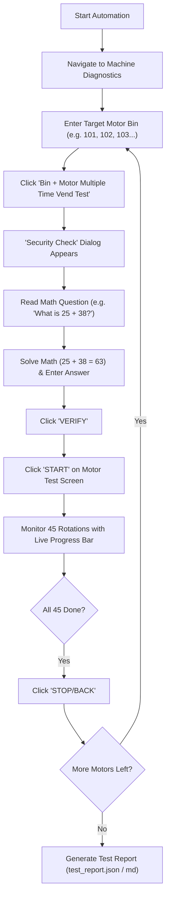

# Vending Machine Motor Test Automation Suite

Automates the complete motor stress-testing procedure for Android-based smart vending machine controllers.

---

## 📌 Problem & Objective

- **Total Motors**: 45 motors per machine (typically 5 trays $\times$ 9 slots, or 6 trays).
- **Test Cycles**: 45 continuous rotations per motor = **2,025 rotations** per machine.
- **Manual Bottlenecks**:
  1. Manually clicking the Bin number input and typing the next bin.
  2. Clicking "Bin + Motor Multiple Time Vend Test".
  3. Solving the popup **Security Check** arithmetic calculation (e.g., *"What is 25 + 38?"*).
  4. Clicking "VERIFY".
  5. Clicking "START" and waiting ~4.5 minutes per motor.
  6. Clicking "STOP/BACK" and repeating for 45 motors (takes **~3.5 to 4 hours of manual labor**).

This suite automates **100% of the manual mouse and typing workflow**.

---

## 🚀 How It Works



---

## 🛠️ Two Automation Modes

### Mode 1: ADB Automation (`vending_adb_automator.py`) — **Recommended**
- **Direct connection** to the vending machine's Android board via USB cable or local Wi-Fi.
- **100% reliable**: Directly inspects the UI hierarchy via UIAutomator XML.
- **Zero OCR errors**: Extracts `"What is 25 + 38?"` as exact text and computes `63` instantly.
- **No mouse drift**: Clicks exact UI button bounds automatically, regardless of screen resolution.
- **Headless**: Can run in the background while you do other work.

### Mode 2: Screen Mouse Automation (`vending_mouse_automator.py`)
- Used if the machine screen is mirrored on your PC monitor (e.g., via `scrcpy` or an HDMI capture card).
- Uses `pyautogui` and `pytesseract` to click buttons and read the security check question via OCR.
- Includes a simple interactive calibration wizard (`calibrate_screen.py`).

---

## 📂 Project Structure

| File | Purpose |
|---|---|
| [`config.example.json`](config.example.json) | Sample configuration template (copy to `config.json` before running) |
| [`vending_adb_automator.py`](vending_adb_automator.py) | Closed-loop ADB motor runner (UI state check, math solver, 45-cycle loop, push alerts) |
| [`connect_to_machine.py`](connect_to_machine.py) | Interactive Wi-Fi ADB connection helper |
| [`find_vending_box_ip.py`](find_vending_box_ip.py) | Subnet scanner to locate vending boards listening on ADB port 5555 |
| [`vending_mouse_automator.py`](vending_mouse_automator.py) | Mouse click & OCR automation script for PC screen-mirroring setups |
| [`calibrate_screen.py`](calibrate_screen.py) | Wizard to calibrate screen coordinates on any monitor resolution |
| [`setup_adb.ps1`](setup_adb.ps1) | PowerShell helper to download Google Android Platform-Tools (`adb`) |

---

## ⚡ Quick Start Guide

### Step 1: Install ADB & Configure
1. Download Google Android Platform-Tools:
   ```powershell
   powershell -ExecutionPolicy Bypass -File setup_adb.ps1
   ```
2. Copy `config.example.json` to `config.json` and set your vending board's IP and notification topic:
   ```powershell
   cp config.example.json config.json
   ```

### Step 2: Connect to the Machine
Connect your laptop to the vending machine controller board over USB or Wi-Fi (ADB port `5555`):
```bash
python find_vending_box_ip.py   # Optional: scan local subnet for ADB port 5555
python connect_to_machine.py    # Connect ADB and update config.json
```

### Step 3: Configure Motor List
Open `config.json` to verify or adjust your machine's bin numbers:
```json
"motors": [
  101, 102, 103, 104, 105, 106, 107, 108, 109,
  201, 202, 203, 204, 205, 206, 207, 208, 209,
  301, 302, 303, 304, 305, 306, 307, 308, 309,
  401, 402, 403, 404, 405, 406, 407, 408, 409,
  501, 502, 503, 504, 505, 506, 507, 508, 509
]
```

### Step 3: Run the Automation!
```bash
# Test all 45 motors automatically
python vending_adb_automator.py

# Or resume from a specific motor (e.g. bin 103)
python vending_adb_automator.py --start-from 103

# Or test a single motor
python vending_adb_automator.py --motor 102

# Dry-run test (simulates without physical clicks)
python vending_adb_automator.py --dry-run
```

---

## 📊 Test Report Output

Upon completion (or abort), the tool automatically generates:
- `test_report.json`: Detailed machine-readable test data.
- `test_report.md`: Markdown summary table with PASS/FAIL status and rotation durations.
