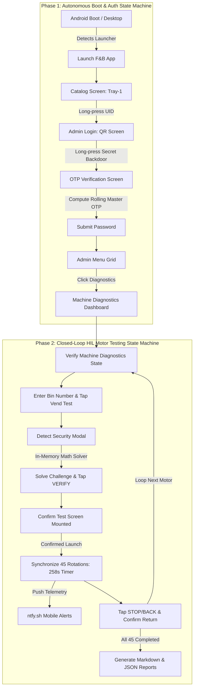

# 🤖 Autonomous Android IoT Vending Machine HIL Test Suite

[](https://www.python.org/)
[](https://developer.android.com/tools/adb)
[](#-architecture)
[](https://www.vendiman.com)
[](LICENSE)
[](https://ntfy.sh/)

> 🏢 **Enterprise Case Study**: Designed and engineered by **Harsh Kalim** during the **Junior Executive – IT & Digital** role at **Vendiman Private Limited** (Mumbai, India) to automate physical IoT spiral motor QA and mechanical endurance stress testing on smart vending kiosks.

An enterprise-grade, **Hardware-in-the-Loop (HIL)** test automation suite designed for Android-based smart vending machine controllers. 

It autonomously manages the entire testing lifecycle: from **device boot & rolling master OTP authentication**, to **UI state recovery**, **arithmetic challenge solving**, **automated Red Cross jam detection**, and continuous **45-motor mechanical stress endurance testing** (2,025 continuous physical coil rotations), cutting testing time from **3.5+ hours of manual labor to 100% hands-free execution**.

---

## 📌 The Problem & Business Impact

Smart vending kiosks undergo rigorous endurance and QA testing before field deployment:
* **The Scale**: 45 physical spiral/conveyor motors per kiosk across 6 trays.
* **The Stress Benchmark**: Each motor must execute **45 continuous rotations** ($\approx$ 258 seconds per motor) = **2,025 rotations** per machine.
* **The Bottleneck**: Performing this manually requires an operator to stand in front of the kiosk for **~3.5 to 4 hours**, repeating a tedious 6-step loop for every single motor:
  1. Booting the app and entering hidden admin backdoors.
  2. Calculating date-dependent rolling OTP passwords.
  3. Typing 3-digit bin slot numbers (`100` to `609`).
  4. Solving arithmetic security challenges (*"What is 38 + 16?"*).
  5. Monitoring physical motor rotation countdowns.
  6. Tapping STOP/BACK and repeating 45 times.

**This suite automates 100% of this workflow with closed-loop verification, adaptive retries, and mobile push telemetry.**

---

## 🏗️ Architecture & State Machine

The suite is engineered around **two synchronized closed-loop state machines** that probe the live Android View Hierarchy before taking action:



---

## ⚡ Key Engineering Highlights

### 1. Zero-Lag Android Performance Tuning
Default Android window and transition animations introduce artificial latency. Combined with UiAutomator's `waitForIdle` timeout (which stalls when text fields have blinking cursors), early automation suffered a 45-second screen transition lag.
* **The Fix**: The controller globally suppresses animation scales directly on the Android OS:
  ```bash
  adb shell settings put global window_animation_scale 0
  adb shell settings put global transition_animation_scale 0
  adb shell settings put global animator_duration_scale 0
  ```
  Screen transition latency dropped from **45 seconds to < 1.5 seconds**.

### 2. In-Memory Security Solver (Bypassing Slow OCR)
When triggering a vend test, the kiosk presents a dynamic security popup (*"What is 38 + 16?"*). Instead of using slow, brittle Optical Character Recognition (OCR), the system directly inspects the accessibility node tree in memory, solves the arithmetic in `< 10ms`, and auto-submits the answer.

### 3. Dynamic Rolling Master Password Engine
The kiosk admin backdoor uses a daily rolling OTP algorithm based on target dates:
$$\text{OTP} = \text{"Vman@"} + (\text{Day} + 1)\%d + \text{Month}\%m$$
The bootstrapper automatically computes today's valid master password and injects it via Android's native `KEYCODE_AT (77)` event to bypass shell character dropping.

### 4. Non-Blocking Push Telemetry
To allow operators to walk away during the 3.5-hour test run, push telemetry dispatches in background daemon threads via `ntfy.sh`. HTTP timeouts or network jitter never interrupt precision motor timing.

### 5. Automated Motor Jam & "Red Cross" Fault Detection
During spiral rotation testing, mechanical friction or motor stalls cause the kiosk UI to display a **Red Cross mark** on that rotation box instead of a Green Checkmark:
* **Live Visual Matrix Analysis**: Periodically scans the RGB pixel data of all 45 rotation boxes ($R > 180, G < 70, B < 70$).
* **Instant Incident Telemetry**: When a Red Cross is detected, it logs the exact rotation index (e.g. `Rotation #17`), prints an in-terminal alert, and fires an **urgent mobile push notification** via `ntfy.sh`.
* **Permanent Audit Trail**: Test reports record the incident as `❌ FAIL (Red Cross on Rot #[17])` so maintenance teams know exactly which slot and rotation stalled.

---

## 📂 Project Structure

```text
vending-machine-motor-automation/
│
├── 🚀 0_start_full_automation.bat  # 1-Click: Master End-to-End Runner (Tray-1 -> 45 Motors)
├── 🔍 1_find_ip.bat                # 1-Click: Scans local subnet for vending machine IP
├── 🔌 2_connect.bat                # 1-Click: Connects ADB over Wi-Fi
├── ⚙️ 3_run_motor_test.bat         # 1-Click: Motor testing only (from Diagnostics screen)
│
├── 🐍 boot_to_diagnostics.py       # Autonomous login state machine (UID -> Backdoor -> OTP)
├── 🐍 vending_adb_automator.py     # 45-motor stress testing closed-loop engine
├── 🐍 connect_to_machine.py        # Wi-Fi ADB connection helper
├── 🐍 find_vending_box_ip.py       # Subnet scanner for ADB port 5555
│
├── 📁 logs/                        # Generated test reports (MD & JSON audit files)
├── 📁 platform-tools/              # Android Platform-Tools binaries (adb.exe)
│
├── ⚙️ config.example.json          # Configuration template
├── 📦 requirements.txt             # Python dependencies
├── 🛡️ .gitignore                   # Git hygiene & security rules
├── 📜 LICENSE                      # MIT Open-Source License
├── 📖 README.md                    # Project documentation
└── 📋 OPERATOR_GUIDE.md            # Daily operator quick-start manual
```

---

## 🚀 Quick Start Guide

### 1. Prerequisites
* Python 3.9+
* Windows / Linux / macOS
* Wi-Fi ADB or USB connection to the Android vending controller

### 2. Setup
Clone the repository and install dependencies:
```bash
git clone https://github.com/harshkalim07/vending-machine-motor-automation.git
cd vending-machine-motor-automation
pip install -r requirements.txt
```

Copy the configuration template:
```bash
cp config.example.json config.json
```

### 3. Connect to Kiosk
Find and connect to the kiosk board over Wi-Fi:
```bash
# Scan local subnet for ADB-enabled boards
python find_vending_box_ip.py

# Connect to target board (e.g. 192.168.1.100:5555)
python connect_to_machine.py
```

### 4. Run the Full Automation!
From the main catalog screen or launcher:
```bash
# Complete end-to-end flow: Auto-Login -> Diagnostics -> 45 Motors
python boot_to_diagnostics.py && python vending_adb_automator.py
```
*(On Windows, simply double-click `0_start_full_automation.bat`)*

#### Flexible Execution Options:
```bash
# Resume testing from a specific motor (e.g., Bin 500)
python vending_adb_automator.py --start-from 500

# Test a single motor slot only (e.g., Bin 302)
python vending_adb_automator.py --motor 302

# Dry-run mode (simulates workflow without sending taps)
python vending_adb_automator.py --dry-run
```

---

## 📊 Automated Audit Reports

Upon completion, structured audit reports are generated automatically inside the `logs/` directory:

### `logs/test_report.md`
```markdown
# Vending Machine Motor Test Automation Report
- **Total Motors Tested**: 45
- **Passed**: 45
- **Failed / Timeout**: 0
- **Total Duration**: 193.5 minutes

| Bin Number | Status | Duration (s) | Timestamp |
|------------|--------|--------------|-----------|
| 100 | ✅ PASS | 258.1s | 2026-11-13 11:35:10 |
| 101 | ✅ PASS | 257.9s | 2026-11-13 11:39:28 |
| ... | ... | ... | ... |
| 609 | ✅ PASS | 258.0s | 2026-11-13 14:48:40 |
```

---

## 📱 Mobile Push Telemetry (ntfy.sh)

Operators receive real-time notifications on iOS/Android:
* `Motor #100 Running (1/45)` $\rightarrow$ ETA & progress.
* `Motor #100 PASS ✅` $\rightarrow$ Completed 45 rotations.
* `🎉 Vending Machine Test Complete!` $\rightarrow$ Full summary report.

---

## 🛡️ License

This project is licensed under the [MIT License](LICENSE).
